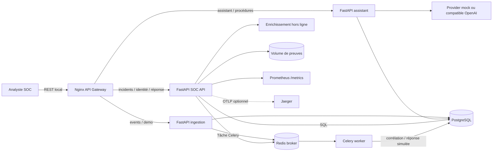
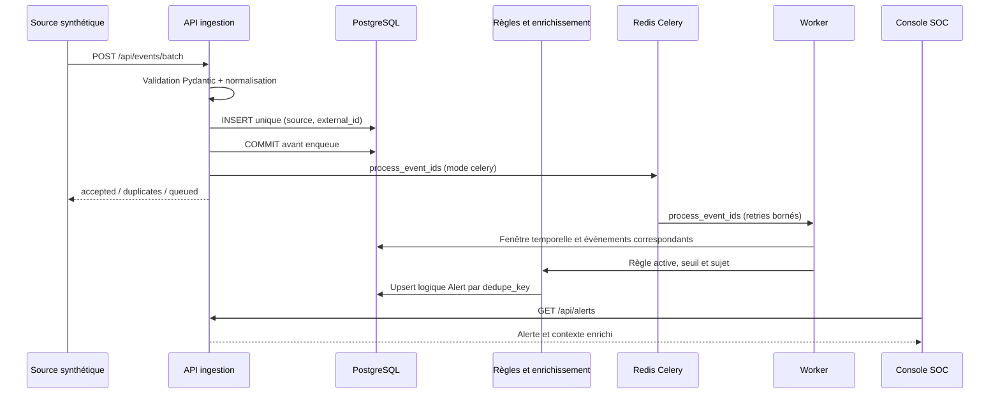
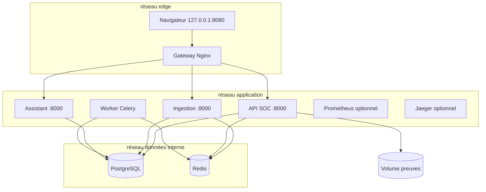
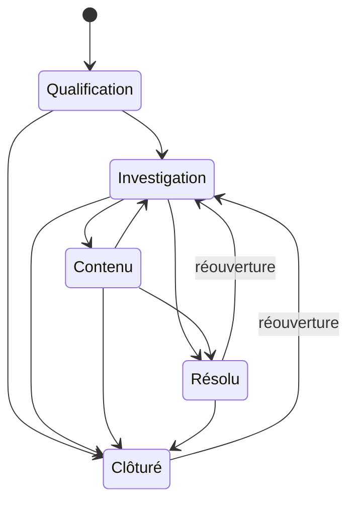

# Architecture et exploitation

## Composants et responsabilités

| Composant | Responsabilité | Contrats principaux |
|---|---|---|
| Nginx gateway | Sert la console, relaie REST, applique limites de corps et timeouts | HTTP vers API |
| FastAPI SOC API | Identité/RBAC, ingestion, règles, enrichissement, alertes, incidents, assistant, notifications, réponse, audit | REST JSON, OpenAPI |
| Worker Celery | Corrèle les événements et joue les playbooks non sensibles simulés en arrière-plan | Tâches Redis `sentinel.events` |
| PostgreSQL | État métier, événements normalisés, audit et chronologie | SQLAlchemy / Alembic |
| Redis | Broker Celery, résultats temporaires et messages en échec | Redis protocol |
| Volume preuves | Fichiers reçus avec nom aléatoire et SHA-256 | Métadonnées JSON liées à l’incident |
| Providers hors ligne | Réputation IP/domaine et contexte utilisateur/actif synthétiques | fonctions déterministes |
| Prometheus / Jaeger | Métriques API et traces OTLP, profils optionnels | `/metrics`, OTLP HTTP |

Trois services HTTP sont déployés indépendamment avec `SERVICE_ROLE=core`, `ingestion` et `assistant`. Ils partagent une image et le schéma SQL du laboratoire; il s’agit de microservices à stockage partagé, sans prétendre à une isolation complète des données. La route de chaque service est filtrée au démarrage; chaque requête vérifie le JWT et le rôle dans le service destinataire. Le mode `all` sert aux tests et au développement local.

## Vue logique

## Flux d’événements

Le mode `ASYNC_MODE=inline` exécute la même corrélation avant la réponse. En mode Celery, les événements sont commités avant l’enqueue pour éviter une course worker. La contrainte unique événement et la `dedupe_key` protègent les rejeux au niveau métier. Le worker acquitte tardivement, limite les reprises à trois, puis dépose les erreurs dans Redis. Une outbox durable et un replay opérateur restent à construire en production.

## Déploiement local

Seul le gateway publie un port, lié à la boucle locale. PostgreSQL/Redis ne publient aucun port. Le réseau `data` est interne. Le worker est non-root et utilise la même image applicative.

## Cycle de vie d’un incident

## Sécurité et observabilité

- JWT HS256 à durée courte; PBKDF2-SHA256 salé; rôles vérifiés à chaque route sensible.
- Entrées Pydantic strictes; lot max 200; preuve max 4 Mio; nom de fichier non utilisé comme chemin; SHA-256 conservé.
- Limiteur par IP en mémoire, utile au labo uniquement, non partagé entre replicas.
- Les mutations sont auditées. Les notifications sont isolées par utilisateur. Les logs structurés excluent les secrets.
- Prometheus scrape `/metrics`. L’instrumentation FastAPI/SQLAlchemy/Celery et l’export OTLP vers Jaeger sont désactivés par défaut.
- L’IA n’a pas d’outil. Journaux et documents sont des données non fiables. Les playbooks sensibles n’ont qu’un résultat simulé.

Avant entreprise : SSO/MFA, Vault/KMS, TLS interne, isolation tenant, RBAC par ressource, limite distribuée, DLQ persistante, antivirus, stockage immuable, rétention/purge, sauvegardes/restauration, alerting SLO, HA, tests de charge/failover et dimensionnement par EPS.

## Comportements vérifiables et limites

- La publication de collecte intervient après le commit du run. Une relivraison Celery ne réexécute pas un run terminé; PostgreSQL verrouille le run pendant l’exécution et l’approbation.
- La corrélation verrouille les règles dans PostgreSQL pour sérialiser les mises à jour concurrentes. Les identifiants de preuves sont conservés dans le contexte. Après clôture, une nouvelle génération ignore les événements de la génération précédente.
- Le scénario HTTP passe par `/api/events/batch`, attend l’alerte puis la collecte, contrôle les refus RBAC, vérifie l’empreinte d’une preuve et exporte le dossier clôturé. Le bouton de démonstration utilise aussi des données synthétiques, avec corrélation immédiate pour l’interactivité.
- Les providers de contexte sont synthétiques. Désactiver une source configurée bloque son ingestion; les sources de laboratoire inconnues restent acceptées pour les scénarios.
- Le corpus de procédures est embarqué et versionné en code. La recherche lexicale fonctionne hors ligne; elle ne constitue pas une recherche vectorielle, et aucune procédure ne déclenche d’outil.
- Les paramètres de règles se règlent dans l’administration. Le limiteur mémoire est propre à chaque processus et peut regrouper des clients derrière un proxy : remplacer par des quotas distribués avant exposition publique.
- L’outbox SQL et le rejeu opérateur des messages morts restent à réaliser avant production. Une interruption entre commit et publication peut perdre un traitement; les contraintes SQL seules ne rendent pas cette fenêtre atomique.
